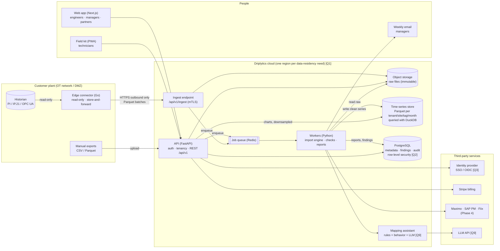

# Driplytics: architecture overview

**Status:** proposal for review (Phase 0). The decisions marked **[Q#]** depend on your answers in `docs/questions.md`.

Driplytics turns historian data the plant already records into a short, dollar-ranked list of water and energy losses. The system has one hard rule: **data only ever flows out of the plant, and nothing ever writes back to a control system.**

## System diagram

The same containers run in all three deployment modes (§8). Only the transport changes: (A) file upload, (B) Go edge connector, (C) everything inside the customer's network, with the LLM disabled or pointed at a model they host.

## Component responsibilities

| Component | Responsibility | Does NOT do |
|---|---|---|
| **Edge connector** (Go, Phase 3) | Reads allow-listed tags read-only from PI Web API / OPC UA / IP.21. Buffers locally. Pushes signed, idempotent Parquet batches out over HTTPS. Sends a heartbeat. | Never accepts inbound connections, never writes to a historian or control system, no analytics. |
| **API** (Python, FastAPI) | Authentication and roles, tenant scoping on every request, uploads, CRUD for sites/assets/mappings/settings, serving findings and downsampled chart data, billing limits, audit logging. | No heavy computation inside requests: anything over ~1 s becomes a job. |
| **Ingest endpoint** (part of API) | Mutual-TLS authentication of connectors, checksum and batch-ID de-duplication, writes raw batches to object storage, enqueues import jobs. | No parsing in the request path. |
| **Job queue + workers** (Python, Redis) | Runs the `engine/` import pipeline (accounting, DST, quality, units, totalizers), the check plugins, the loss model, pilot-report PDFs and weekly emails. Jobs are idempotent and retryable, with progress reported to the UI. | No direct user traffic. |
| **Import engine** (`engine/`, existing) | The guarantees in §4: every value accepted / rejected / duplicate, the counts balance, unmapped tags block scoring. | No knowledge of tenants or HTTP: a pure library, callable from workers and tests. |
| **Check plugins** (Python) | One file per check: declares required roles, returns FLAGGED / CLEAR / INCONCLUSIVE / SKIPPED with plain reasons, evidence and estimated loss. | Never guesses when inputs are missing. |
| **Mapping assistant** | Naming-convention rules, then behavioral detection, then (optionally) LLM suggestions with confidence and rationale. Learns from confirmed mappings. | Never sends raw time series to an LLM; works with the LLM off. |
| **PostgreSQL** | Tenants, users, sites, assets, tags, mappings, imports and reports, check runs, findings, workflow, savings, billing usage, audit log. Isolation by row-level security [Q2]. | No bulk time-series data. |
| **Object storage** (S3-compatible) | Raw uploads and connector batches, immutable and kept for audit. Pilot reports and exports. | — |
| **Time-series store** (Parquet + DuckDB) | Clean, unit-converted UTC series, partitioned `tenant/site/tag/month`. Serves check inputs and downsampled chart queries. | No transactional updates; corrections are new partitions plus a pointer swap. |
| **Web app** (Next.js) | All screens in §12, the design system (tokens + Storybook), white-label theming, charts with server-side downsampling. | No business logic beyond display; it trusts the API. |
| **Field kit** (PWA, same codebase) | Offline verification jobs, clamp-on uploads, clock-offset capture, photos, confirm/deny. | — |

## Key flows

1. **Upload → first finding (pilot):** upload file → raw to object storage → import job (engine) → import report shown → mapping assistant fills gaps → user confirms → checks run → loss model → ranked worklist. Target: **under 1 working day**, under 1 hour of user time.
2. **Connector streaming (production):** connector batch → ingest → import job (incremental, per tag) → checks re-run on a schedule (default hourly), plus on demand.
3. **Finding lifecycle:** detected → (verify in field) → work order → fixed → savings measured over a window → **verified savings** in the ledger.

## Cross-cutting decisions (proposed; each gets an ADR)

| Topic | Proposal | Why |
|---|---|---|
| Repo | **Monorepo**: `apps/web`, `apps/api`, `services/worker`, `engine/`, `connector/` (Go, Phase 3), `packages/ui`, `packages/contracts`, `infra/`, `docs/` | One place for contracts and one CI pipeline; a solo founder plus an AI agent move faster |
| Python tooling | `uv` workspaces, Ruff, mypy (strict for new code), pytest | Fast and simple |
| JS tooling | pnpm workspaces + Turborepo, ESLint, Prettier, Vitest, Playwright | Standard for Next.js monorepos |
| Job queue | **Arq** (async, Redis) | Lighter than Celery and fits the FastAPI async style; revisit if we need complex workflows |
| API contract | OpenAPI generated from FastAPI → generated TypeScript client for the web app | One source of truth, typed end to end |
| Tenancy | Shared Postgres schema + `tenant_id` on every row + **row-level security** [Q2] | Cheapest to run, with strong isolation when enforced in the database, not just in code |
| Time | UTC everywhere in storage; site time zone shown in the UI | Already how the engine works |
| Units | Stored in the canonical target unit per tag; display unit chosen per site [Q7] | |
| Environments | `local` (Docker Compose) → `staging` → `prod`; infrastructure as code with Terraform | |
| Observability | Structured JSON logs, OpenTelemetry traces, per-tenant job metrics, Sentry for errors | |
