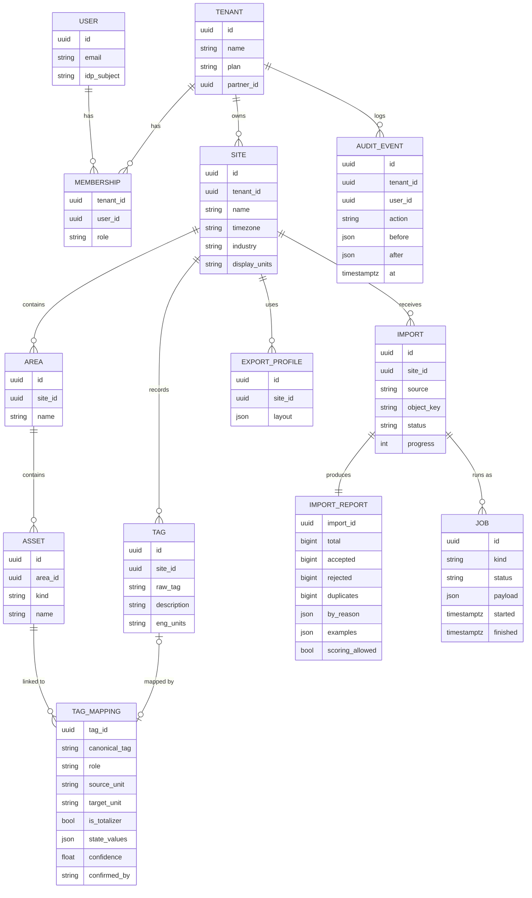

# Phase 0 design note: foundations (weeks 1–2)

**Goal:** a running skeleton you can demo. Sign in, create a site, upload a historian export, watch it import, and see the **import report** in a real UI built on the Driplytics design system. All on synthetic data, all started with one command.

**Not in Phase 0:** tag-mapping UI, checks, worklist, findings, billing, connector. Those are Phase 1+. Wireframes for the Phase 1 screens are included here (see `docs/wireframes/index.html`) so you can react to them early.

## 1. Scope

| # | Deliverable | Done when |
|---|---|---|
| 1 | **Monorepo + tooling** | `pnpm i && uv sync` works; `make dev` starts everything; linters and type checks pass in CI |
| 2 | **Local environment** (Docker Compose) | Postgres, Redis, MinIO (S3), Mailpit, API, worker, web, all healthy with one command |
| 3 | **Multi-tenant data model** + migrations | Tables below exist with row-level security; a test proves tenant A can't read tenant B's rows |
| 4 | **Auth** (OIDC-based, WorkOS in the cloud, Keycloak locally (ADR 0004)) | Sign-in/out, organization membership, roles (Owner, Admin, Engineer, Technician, Viewer, Partner) enforced in the API |
| 5 | **Engine as a service** | Worker runs `engine/` import jobs from object storage; progress updates; report stored in Postgres; clean series written as Parquet |
| 6 | **Upload + import report UI** | Drag-and-drop upload → progress → import report screen (§12.4 #4) with the balanced stacked bar, reasons table, examples and CSV download of rejected rows |
| 7 | **Design system** | Tokens (light/dark), base components in Storybook (Button, Input, Table, Chip, Card, Banner, Stat, Empty state, Skeleton, Dialog, Toast), app shell (sidebar, top bar, site switcher) |
| 8 | **Wireframes** | Low-fidelity wireframes of 5 key screens reviewed by you. ✅ Live demo: https://storage.googleapis.com/driplytics-demo/index.html |
| 9 | **CI** | GitHub Actions: lint, types, unit tests (engine, API, web), the engine benchmark (smoke size), a Playwright test of upload → report, and an axe accessibility check |
| 10 | **ADRs** | ✅ 0001–0016 written (`docs/decisions/`) |
| 11 | **Demo tenant** | "Riverbend Water Treatment (synthetic)" seeded with a mapping and 30 days of generated data |

## 2. Repository layout

```
driplytics/
├── CLAUDE.md
├── apps/
│   ├── api/                 FastAPI app (routers, auth, tenancy, schemas)
│   └── web/                 Next.js app (App Router) + field-kit PWA routes
├── services/
│   └── worker/              Arq worker: import, (later) checks, reports, email
├── engine/                  existing plant_ingest package (pure library)
├── connector/               Go edge connector (Phase 3, empty placeholder + README)
├── packages/
│   ├── ui/                  design tokens + React components + Storybook
│   └── contracts/           OpenAPI spec (generated) + generated TS client
├── infra/
│   ├── docker/              Dockerfiles, Keycloak realm (compose.yaml lives at the repo root)
│   └── terraform/gcp/       minimal GCP demo environment (ADR 0007); terraform/aws/ at migration
├── docs/
│   ├── architecture.md  questions.md  decisions/  phase0/  wireframes/
├── compose.yaml             local stack
├── tasks.ps1 / Makefile     dev, test, lint, bench (Windows / macOS-Linux)
```

## 3. Data model (Phase 0 tables; Phase 1+ tables listed for context)



- Every tenant-owned table has `tenant_id` (denormalized where needed) and a **row-level security policy** `tenant_id = current_setting('app.tenant_id')`. The API sets it per request inside a transaction.
- **Phase 1+ tables:** `check_run`, `finding`, `finding_event` (status timeline), `loss_model`, `verification`, `work_order_link`, `savings_entry`, `connector`, `subscription_usage`.
- **Time series are not in Postgres.** Clean series go to `s3://…/tenant=<id>/site=<id>/tag=<canonical>/month=YYYY-MM/part-*.parquet`.

## 4. Key interfaces

**API (Phase 0 endpoints)**
```
POST   /api/v1/sites                          create site
GET    /api/v1/sites/{id}
POST   /api/v1/sites/{id}/imports             presigned upload URL → returns import id
POST   /api/v1/imports/{id}/start             enqueue import job (with export profile + mapping)
GET    /api/v1/imports/{id}                   status + progress
GET    /api/v1/imports/{id}/report            ImportReport JSON
GET    /api/v1/imports/{id}/rejected.csv      rejected rows download
GET    /api/v1/me                             user, memberships, roles
```

**Worker job:** `import_file(import_id)` → load the profile and mapping → `engine.import_large_file()` → write Parquet partitions → store `IMPORT_REPORT` → mark the import done. Progress is published every ~5 s (rows processed / estimated total).

**Engine changes (small, no behavior change):** rename the package to `driplytics_engine`, accept object-storage paths via fsspec, add a progress callback, and keep all 53 tests green.

## 5. Risks and mitigations in Phase 0

| Risk | Mitigation |
|---|---|
| Auth vendor choice delays everything | Code against an OIDC interface; dev uses a local Keycloak container until [Q3] is answered |
| Row-level security mistakes leak data across tenants | Database-level policies + an automated cross-tenant test suite that runs on every PR |
| Big uploads time out | Direct-to-storage presigned uploads (multipart), never through the API process |
| Design drifts from §12 | Storybook first; pages may only use `packages/ui` components; visual regression in CI |
| pyarrow missing in some environments | Containers pin pyarrow; the engine's pickle fallback stays only for tests |

## 6. ADRs to write in Phase 0

0001 Record architecture decisions · 0002 Monorepo and tooling · 0003 Tenancy isolation (RLS) [Q2] · 0004 Auth via OIDC + vendor [Q3] · 0005 Time-series storage (Parquet + DuckDB) · 0006 Job queue (Arq) · 0007 Cloud provider: GCP first, portable to AWS (accepted) · 0008 Design system (Tailwind + shadcn/ui + tokens)

## 7. What I need from you

1. ~~Answers to `docs/questions.md`~~ ✅ Done: see `docs/decisions/`.
2. Feedback on the wireframes in `docs/wireframes/index.html`.
3. A GitHub repository (private) and whether CI should run on GitHub Actions.
4. If you have them: logo, brand color preference, and the domain (driplytics.com) registration status.
